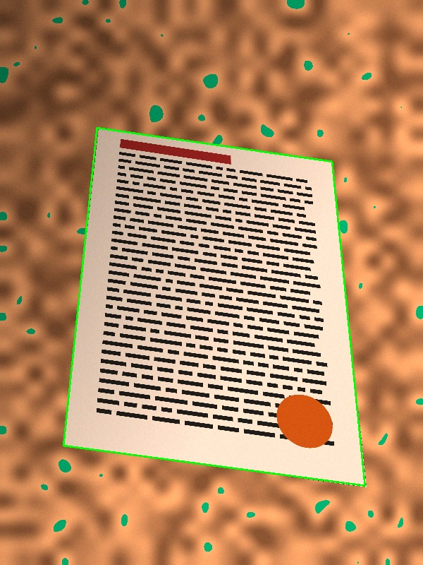
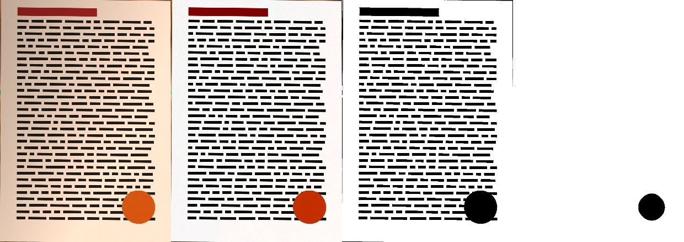

# ScanDoc

A simple Android document scanner. Photograph one or more pages, let the app find the
sheet's four corners, adjust them if needed, straighten the page, apply a color-correction
filter, and export everything as a lightweight PDF to share on WhatsApp.

The user interface is in Italian.

<p align="center">
  
  &nbsp;
  
</p>

## Features

- **Documents library**: the home screen lists all saved documents (thumbnail, name,
  page count, last modified date). Each scan session is saved as a document.
- **Capture**: in-app camera (CameraX, 4:3, max quality, flash toggle) or import of one
  or many images from the gallery.
- **Automatic corner detection**: the app proposes the four corners of the sheet as soon
  as the photo is taken.
- **Manual adjustment**: drag the corners, or drag the edge handles to move a whole side.
  A magnifier loupe appears while dragging a corner. *Auto* re-detects and *Tutta* selects
  the whole image. Invalid (non-convex) shapes are highlighted in red.
- **Perspective correction** that recovers the real aspect ratio of the sheet, so pages
  shot at an angle are not stretched.
- **Filters** (live thumbnails): Originale, Auto colore, Sbianca / no ombre,
  Bilanciamento bianco, Più contrasto, Colori vivaci, Scala di grigi, Bianco e nero.
  The last filter used becomes the default for the next page.
- **Page management**: inside a document you can add pages (camera or gallery),
  re-edit a page (corners, filter, rotation), delete pages and reorder them.
- **Documents**: rename (the name becomes the PDF file name) and delete.
- **PDF export**: A4 pages or pages fitted to the image. JPEGs are embedded without
  re-compression, so files stay small. Sharing goes directly to WhatsApp / WhatsApp
  Business, or to any other app through the system share sheet.
- Everything is stored locally in the app's private storage and survives app restarts.

## Usage

1. Tap **Scansiona** (camera) or **Importa** (gallery).
2. Check the proposed corners, adjust them if needed, then tap **Avanti**.
3. Pick a filter and optionally rotate the page. Tap **Salva**, or **Salva + altra** to
   shoot the next page of the same document.
4. In the document screen, tap the title to rename it, then **Esporta PDF e condividi**
   and choose **Invia con WhatsApp** or **Altre app**.

## Building

Requirements: JDK 17 and the Android SDK (platform 35). Android Studio is the easiest
option: open the project folder and press *Run*.

From the command line:

```bash
# Tell Gradle where the SDK is (or set ANDROID_HOME)
echo "sdk.dir=$HOME/Android/Sdk" > local.properties

./gradlew assembleDebug          # APK -> app/build/outputs/apk/debug/app-debug.apk
./gradlew testDebugUnitTest      # unit tests
adb install -r app/build/outputs/apk/debug/app-debug.apk
```

### Release builds and size

OpenCV ships native libraries for each CPU architecture, so the universal debug APK is
about 110 MB. To publish, build an App Bundle so each device downloads only its own
architecture (a much smaller install):

```bash
./gradlew bundleRelease
```

The `release` build type enables R8 minification. It is currently signed with the debug
key. Configure your own `signingConfig` before distributing the app.

The APK includes `arm64-v8a`, `armeabi-v7a` and `x86_64` (for emulators); see `abiFilters`
in `app/build.gradle.kts`.

## Tech stack

| Area | Library / version |
|------|-------------------|
| Language / UI | Kotlin 2.0, Jetpack Compose (Material 3) |
| Camera | CameraX 1.4 |
| Image processing | OpenCV 4.10 (official Maven Central artifact) |
| PDF | Custom minimal writer (no dependency) |
| Build | Gradle 8.10, Android Gradle Plugin 8.7 |
| Android | minSdk 26 (Android 8.0), target/compile SDK 35 |

## Project structure

```
app/src/main/java/com/scandoc/app/
├── MainActivity.kt            # OpenCV init, screen routing, share/toast effects
├── ScanViewModel.kt           # app state, documents, persistence (documents.json)
├── processing/
│   ├── DocumentDetector.kt    # automatic 4-corner detection + sub-pixel refinement
│   ├── PerspectiveCorrector.kt# homography warp + true aspect-ratio estimation
│   ├── Filters.kt             # color-correction filters
│   └── ImageUtils.kt          # EXIF-aware loading, scaling, rotation, JPEG save
├── pdf/
│   └── PdfBuilder.kt          # PDF writer (embedded JPEG) + WhatsApp/share intents
└── ui/
    ├── DocumentsScreen.kt     # home: list of documents
    ├── DocumentScreen.kt      # a document's pages: add / delete / reorder / export
    ├── CameraScreen.kt        # CameraX capture
    ├── CropScreen.kt          # draggable corner editor with magnifier
    ├── FilterScreen.kt        # filter picker and rotation
    ├── Common.kt              # shared dialogs (rename, delete, PDF export)
    └── Theme.kt
```

### Data storage

All files live in the app's private storage (`filesDir`):

- `pages/orig_<uuid>.jpg`: original photo, kept so a page can be re-cropped later
- `pages/page_<id>.jpg`: processed page (max 3508 px, about A4 at 300 dpi), embedded in the PDF
- `pages/thumb_<id>.jpg`: 400 px thumbnail
- `documents.json`: index of documents, page order, corners, filter and rotation per page

Generated PDFs go to `cacheDir/pdf/` and are shared through a `FileProvider`.

## Algorithms

The detection, straightening and filter pipelines are described in
[docs/ALGORITHMS.md](docs/ALGORITHMS.md).

## Permissions

- `CAMERA`: requested at runtime the first time the camera opens.
- Gallery import uses the system Photo Picker, so no storage permission is needed.
- `<queries>` for `com.whatsapp` / `com.whatsapp.w4b`, so the app can target WhatsApp
  directly on Android 11+.
