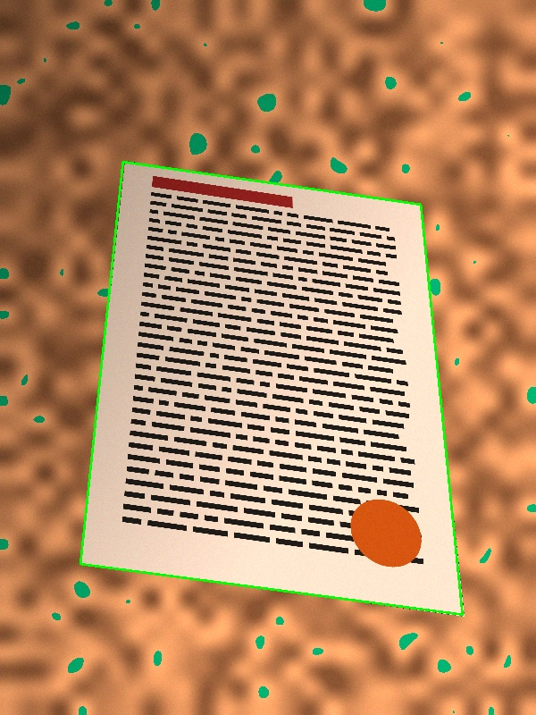
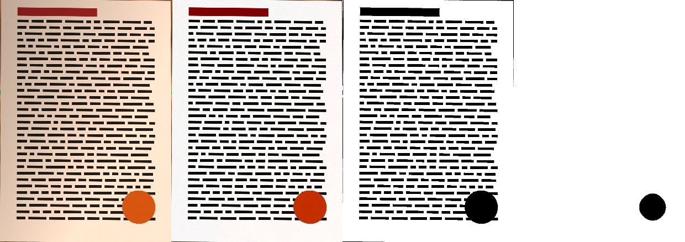

# Image processing algorithms

All processing is done on-device with OpenCV. The code lives in
`app/src/main/java/com/scandoc/app/processing/`.

## 1. Corner detection (`DocumentDetector.kt`)



A single edge detector fails on common cases: white paper on a light table, colored
backgrounds, text close to the border. The detector therefore generates many candidate
quadrilaterals and keeps the best one.

1. **Downscale** the image to about 720 px on the longest side, for speed.
2. **Channels**: grayscale, HSV saturation, and the Lab `a` and `b` channels. Saturation and
   Lab separate white paper from colored or wooden surfaces even when brightness is similar.
3. **Text removal**: Gaussian blur, then a morphological *closing* (9×9, 2 iterations).
   This erases dark printed text and keeps only the sheet outline.
4. **Binary maps** for each channel:
   - Canny with automatic thresholds (0.66× / 1.33× the median), plus two fixed
     threshold pairs (20/60 and 50/150), then a 3×3 dilation;
   - an Otsu threshold on the grayscale channel (paper is usually the brightest blob).
5. **Quadrilateral extraction** from the 8 largest contours of each map:
   convex hull, then `approxPolyDP` with increasing epsilon (1.5% to 7% of the perimeter)
   until exactly 4 vertices remain. If none works, the app takes the
   **maximum-area quadrilateral inscribed in the hull** (exhaustive search over the
   simplified hull vertices).
6. **Filtering**: the candidate must be convex, cover 8% to 99.5% of the image, and have
   interior angles between 35° and 145°. Quads touching the image border on 3 or more
   corners are penalized, because they are usually the frame, not the sheet.
7. **Scoring**: `score = areaFraction × (0.25 + edgeSupport)`, where *edgeSupport* is the
   fraction of points sampled along the perimeter that lie on a detected edge (in the
   union of all edge maps). Candidates with less than 35% support are rejected.
8. **Sub-pixel refinement** at up to 2000 px: each side is re-estimated with a robust
   `fitLine` (Huber loss) on the Canny edge pixels inside a narrow band around that side.
   The 8% of the side nearest each corner is excluded. The four lines are then intersected
   to get the corners. If the adaptive thresholds find too few edge pixels, lower ones
   (15/40, then 8/24) are tried, for low-contrast scenes. A refined result is discarded if
   a side rotates too much, a corner moves too far, or the shape becomes non-convex.

If nothing is found, the editor proposes a default rectangle with an 8% margin, and the
user places the corners by hand.

On synthetic 3000×4000 photos (perspective, shadow, warm cast, sensor noise) the corner
error was 1 to 6 px. Refinement improved precision 3 to 4 times over the 720 px estimate.

Corner order is normalized to TL, TR, BR, BL: points are sorted by angle around the
centroid, and the sequence starts at the point with the smallest `x + y`.

## 2. Perspective correction (`PerspectiveCorrector.kt`)

The page is straightened with a homography (`getPerspectiveTransform` +
`warpPerspective`, bicubic interpolation, replicated borders).

The difficult part is the **output size**. Using the longest visible sides distorts pages
photographed at an angle, by up to about 20% in tests. The app recovers the rectangle's
**true aspect ratio** with the method of

> Z. Zhang, L. He, *Whiteboard scanning and image enhancement*,
> Digital Signal Processing 17(2), 2007.

The method estimates the camera focal length from the projected rectangle, assuming the
principal point is at the image center and pixels are square:

```
m1..m4 = TL, TR, BL, BR in homogeneous coordinates
k2 = ((m1 × m4) · m3) / ((m2 × m4) · m3)
k3 = ((m1 × m4) · m2) / ((m3 × m4) · m2)
n2 = k2·m2 − m1,   n3 = k3·m3 − m1
f² = −[ (n2x·n3x − (n2x·n3z + n2z·n3x)·u0 + n2z·n3z·u0²)
      + (n2y·n3y − (n2y·n3z + n2z·n3y)·v0 + n2z·n3z·v0²) ] / (n2z·n3z)
ratio = sqrt( |A⁻¹·n2|² / |A⁻¹·n3|² ),   A = [[f,0,u0],[0,f,v0],[0,0,1]]
```

When the configuration is degenerate (nearly frontal photo, `f² ≤ 0`) or the result is
implausible (outside 0.15 to 6.5, or more than 2× away from the visible ratio), the visible
ratio is used instead. In a nearly frontal photo the visible ratio is already correct.
Synthetic tests recover the A4 ratio (0.7071) exactly at all tested camera angles.

The output keeps the resolution of the longest visible side and is capped at 3508 px
(A4 at 300 dpi).

## 3. Filters (`Filters.kt`)



*Left to right: straightened photo with shadow and warm cast; "Auto colore";
"Bianco e nero"; the internal "paper" mask (black = not paper).*

### Illumination normalization (base of the document filters)

Each channel is divided by an estimate of the **paper background**. This removes shadows
and lighting gradients and turns the paper uniformly white.

1. At about 600 px: dilation (elliptical kernel, about 1/30 of the size), then a large
   median blur. This removes text and keeps the paper color.
2. A naïve background estimate would also flatten large non-paper regions (photos,
   stamps, colored blocks) and wash them out. To avoid this, the paper level at a larger
   scale is estimated (dilation with a kernel of about 1/4 of the size, then Gaussian blur).
   Pixels darker than 82% of it are marked as **not paper**.
3. In non-paper regions the background is rebuilt by **normalized convolution** from the
   surrounding paper pixels: `blur(bg·mask) / blur(mask)`.
4. Result: `channel / background × 255`.

### Filter list

| Filter | Processing |
|--------|------------|
| Originale | none |
| Auto colore | normalization + gamma 1.6 (deeper ink) + saturation ×1.35 |
| Sbianca / no ombre | normalization + gamma 1.2 |
| Bilanciamento bianco | *Simplest Color Balance* (Limare et al., IPOL 2011): per-channel stretch, clipping 1% at each end. Removes color casts. |
| Più contrasto | CLAHE (clip 2.5, 8×8 tiles) on the L channel of Lab |
| Colori vivaci | color balance (0.5%) + CLAHE (1.5) + saturation ×1.5 |
| Scala di grigi | gray + normalization + gamma 1.5 |
| Bianco e nero | gray + normalization, then Gaussian adaptive threshold combined with global limits: white if (adaptive-white **or** > 209) **and** > 139; then a 3×3 median to remove specks |

Filter previews are computed on a 1400 px copy (thumbnails at 220 px). The full-resolution
image is filtered only when the page is saved.

## 4. PDF writer (`pdf/PdfBuilder.kt`)

The writer is a minimal PDF 1.4 generator. Each page is one image XObject with
`/Filter /DCTDecode`, so the saved JPEG bytes are copied as-is, without re-compression.
Image dimensions come straight from the JPEG SOF marker. Page size is either A4 (portrait
or landscape, following the image orientation, with the image centered) or A4 width with
height proportional to the image. The output is checked by a unit test and opens without
errors in `pdfinfo` / `pdftoppm`.
